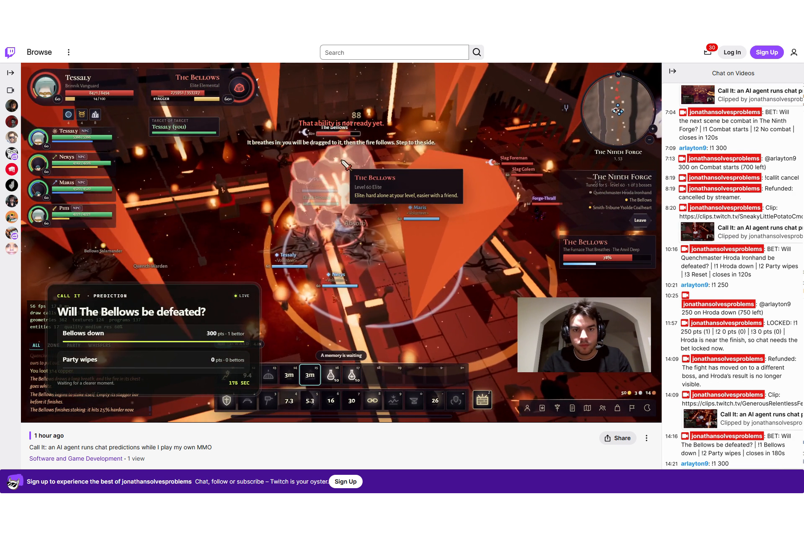
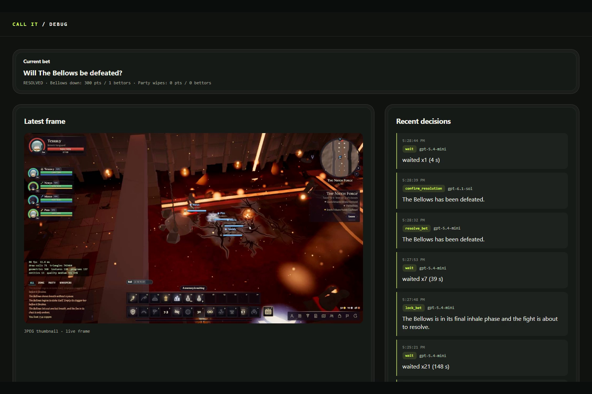
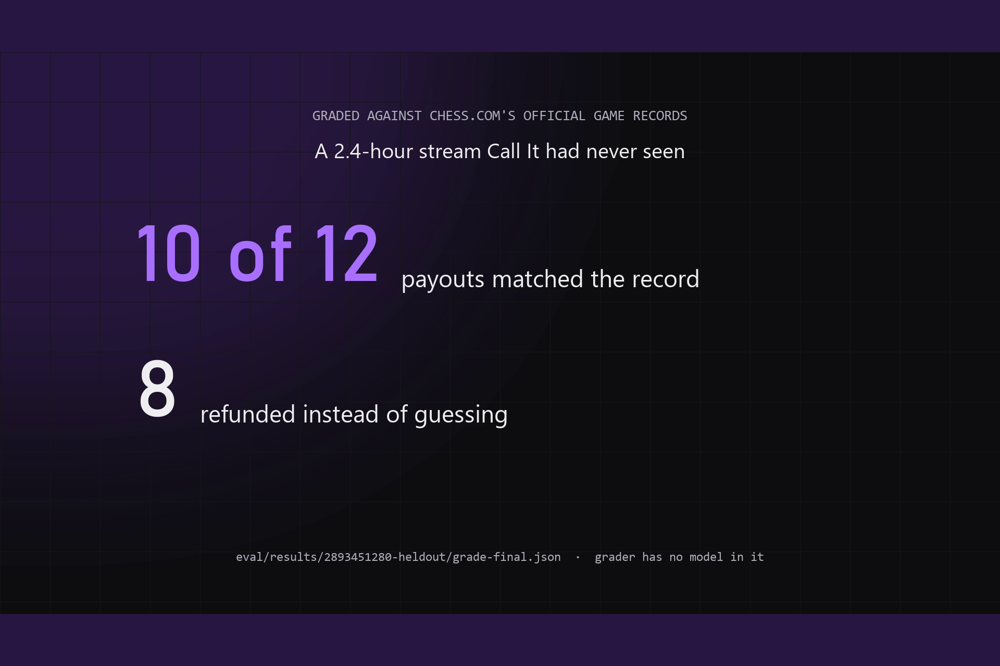

# Devpost submission: final values only

One field per block. Paste as is.

## Project name

```
Call It: AI that runs Twitch Predictions while you play
```

## Elevator pitch

```
An AI agent watches your game and runs Twitch prediction bets in chat: opens, locks, pays out, clips. 10 of 12 payouts matched chess.com records on a stream it had never seen.
```

## Thumbnail

Upload `broll/thumbs/devpost-thumbnail.jpg` (1920x1280, 3:2).

## About the project (Devpost "Project Story", Markdown)

```
## Inspiration

I used to stream WoW on a small channel. Mid-pull, both hands on the keyboard, my chat could only watch. Twitch has a betting game made for that moment, Channel Points Predictions, but it is locked behind Affiliate, and even with it someone has to start every bet and call the result by hand. Small streamers don't have mods to do that. I wanted the bet to run itself while I play.

## What it does

Call It watches your game through OBS and runs prediction bets in your Twitch chat. It opens a bet when a fight is about to start, locks it near the end, settles it when the result is on screen, and posts a clip and a stream marker at the payout. Any channel can run it: no Affiliate, no mods, no server to host.



On my own game (Orvandel, an MMO I built), live on Twitch: a boss title card appears and Call It opens "Will The Bellows be defeated?" in chat. A viewer bets `!1 300` (my main account, playing the viewer). Near the end of the fight it locks. When the kill banner shows, a fast model proposes the result and a second, stronger model checks the frames before anyone is paid. The payout lands in chat with a clip link, and a marker goes into the VOD. When it cannot see a result, it refunds: it once opened a bet while I was talking to a quest-giver, saw no fight, and gave everyone their points back.

**The best result:** replayed on a 2.4-hour chess stream it had never seen, **10 of 12 payouts matched chess.com's official game record**, and it refunded 8 bets instead of guessing.

## How I built it

All product code was written in **OpenAI Codex, in one thread**, from a SPEC.md and an AGENTS.md: 18 prompts, 26 commits, 72 tests. Codex wrote the Twitch EventSub client, the device-code login, the agent loop and tool schemas, the guards and spend caps, the points ledger and payout math, the second look, the clip and marker calls, the overlay, replay mode and the chess grader. Every prompt I sent is in CODEX_PROMPTS.md in order, and the commit history shows the build step by step. I used Claude Code alongside Codex for planning, prompt review, live testing and the evaluation runs.

How it decides: every 4 seconds **gpt-5.4-mini** sees the last three OBS frames, the bet state and its recent decisions, and must call exactly one tool: `wait`, `open_bet`, `lock_bet`, `resolve_bet` or `cancel_bet`. Code never picks the action. It only enforces limits: one bet at a time, a gap between bets, question and outcome length, a timeout refund, spend caps. A proposed payout goes to a **second look on gpt-6.1-sol**, which sees the proposal frames plus newer frames and settles on the outcome the frames prove, or rejects it. Every decision, with the frames it saw, is in the decision log.



Twitch surfaces: EventSub over WebSocket (channel.chat.message, stream.online, stream.offline, channel.ad_break.begin), Helix Send Chat Message, Create Clip, Create Stream Marker, Get Users, Get Streams, the Device Code Grant, and an OBS browser-source overlay.

## Challenges I ran into

- **Grading it honestly.** A demo on my own game proves it runs, not that it is right. I needed a referee I don't control, so I replayed real chess streams through the same loop (1 frame per second from the VOD, fake clock) and graded every game-result payout against chess.com's public game archive with a script that has no model in it.
- **Wrong winners.** On the stream I tuned on, the first version matched only 4 of 10 payouts. It read the wrong player as the winner, or paid out a bet using the result of a different game. The fix was the second look on a stronger model with newer frames, plus prompt rules from the decision logs.
- **No Affiliate.** My channel can't run native Predictions, so Call It runs bets in chat with its own points ledger. That turned out to be the point: it works for exactly the channels Twitch leaves out.
- **Spend.** A test process left running made thousands of model calls before I noticed. Live mode now stops at 600 calls by default, and force-live mode stops after 30 minutes.

## Accomplishments that I'm proud of

- Three real payouts live on Twitch, each with a clip and a stream marker the agent made itself ([VOD](https://www.twitch.tv/videos/2916119628), [clip](https://clips.twitch.tv/SoftSpeedyPassionfruitPunchTrees-mnfpV8CfdPDOgDs2)).
- 10 of 12 on a held-out stream that was never used for tuning. The second look stepped in on 11 of 18 proposed payouts (5 wrong winners corrected, 6 payouts from another game rejected) and was right all 11 times.
- It refunds when it can't see the answer, and says why, instead of guessing.



## What I learned

- Let the model choose and let code enforce limits. Keeping every open, lock, resolve and refund as a model decision is what lets the same loop run on my MMO and on chess streams.
- A second look with newer frames is cheap insurance. The wrong payouts it caught were misreads of one moment, the wrong winner or another game's result, and the newer frames settled them.
- A refund is a good answer. "Couldn't see it, points back" costs chat nothing; a wrong payout costs their trust.

## What's next for Call It

- Native Channel Points Predictions for Affiliate and Partner channels, through the same tools.
- A per-channel memory of which moments chat bets on most.
- Measuring more games and more streamers. The held-out run tests unseen games from one streamer, not an unseen layout.

Limits, stated plainly: the agent reads pixels and can be wrong, which is why every payout gets a second look and the streamer can refund with `!callit cancel`. Points have no cash value. Repo: https://github.com/JonathanSolvesProblems/call-it
```

## How the project meets the main technology requirement

```
Codex: all product code was written in OpenAI Codex, in one thread (session 01a175ec-d56d-77c1-b2ca-0b079719d3ee), from a SPEC.md and an AGENTS.md I wrote first. 18 prompts, 26 commits, 72 tests. Codex wrote the Twitch EventSub client and device-code login, the agent loop and its tool schemas, the guards and spend caps, the chat points ledger and payout math, the second-look check, the clip and marker calls, the OBS overlay, replay mode and the chess grader. Every prompt is in CODEX_PROMPTS.md in the order it was sent, and the commit history shows each step.

Twitch, each product and what it does in Call It:
- EventSub over WebSocket (channel.chat.message): reads viewer bets (!1 300, !2 all) and the streamer's !callit commands.
- EventSub stream.online / stream.offline: the agent only runs bets while the channel is live.
- EventSub channel.ad_break.begin: pauses bet actions during ads so nobody misses a lock or payout.
- Helix Send Chat Message: announces each bet, lock, payout and refund in chat.
- Helix Create Clip: clips the moment at every payout and posts the link in chat.
- Helix Create Stream Marker: drops a marker in the VOD at every payout.
- Helix Get Users and Get Streams: resolves the channel and checks live status.
- Device Code Grant: the streamer logs in from the terminal, no redirect URL or server needed.
- OBS browser source overlay: shows the live bet card on stream, filling as points come in.

OpenAI API (Responses API with function tools and image input): gpt-5.4-mini looks at the last three OBS frames every 4 seconds and calls one tool (wait, open_bet, lock_bet, resolve_bet, cancel_bet). gpt-6.1-sol checks every proposed payout against newer frames before anyone is paid.

OBS WebSocket: captures the frames the agent sees.
```

## How streamers and their community use it

```
Streamer: install it (npm install), log in once with the Twitch device code, add the overlay URL as a browser source in OBS, and run npm run live. Then just play. Call It watches the game and decides when a moment is worth betting on: a boss pull, a fight, a match. It opens the bet in chat, locks it near the end, pays out when the result is on screen, and clips the moment. It works on any channel, including the many small channels that can't use Twitch's own Predictions because they aren't Affiliate yet, and it needs no mods to run the bets. The streamer stays in control with !callit pause, resume, cancel (refunds everyone) and status.

Community: viewers bet from chat with !1 100, !2 all (up to !10), or just !1 for 100 points, and check their balance with !points. Everyone starts with points that have no cash value. They watch the overlay card fill as bets come in, see the lock land before the outcome, and get paid in chat with a clip link to the moment they called. If the agent can't see the result, everyone gets their points back with the reason, so nobody loses points to a guess. Clips and VOD markers mean the best moments are easy to find and share after the stream.
```

## Built with

```
typescript, node.js, openai, codex, gpt-5.4-mini, gpt-6.1-sol, openai-responses-api, twitch-api, twitch-eventsub, twitch-helix, websocket, obs-studio, obs-websocket, vitest, ffmpeg, chess.com-api
```

## Links

```
Repository: https://github.com/JonathanSolvesProblems/call-it
Demo video: https://www.youtube.com/watch?v=IGjhYXjgPrY
Write-up: https://jonathanandrei.com/blog/call-it-ai-runs-twitch-predictions-codex/
Live VOD (Twitch): https://www.twitch.tv/videos/2916119628
Clip Call It made: https://clips.twitch.tv/SoftSpeedyPassionfruitPunchTrees-mnfpV8CfdPDOgDs2
```

## YouTube title

```
An AI runs my Twitch Predictions, no Affiliate needed | Call It (Codex x TwitchCon Hackathon)
```

Thumbnail: `broll/thumbs/thumbnail-long.jpg` (1920x1080).

## YouTube description

```
Call It watches your game through OBS and runs prediction bets in your Twitch chat: it opens them when a fight starts, locks them near the end, settles them when the result is on screen, and posts a clip and a stream marker. Any channel can run it, no Affiliate needed.

Measured on a 2.4-hour chess stream it had never seen: 10 of 12 payouts matched chess.com's official game record, 8 bets refunded instead of guessed. Every payout is checked by a second model before anyone is paid.

Built in OpenAI Codex in one thread (18 prompts, 26 commits, 72 tests) for the Codex x TwitchCon Hackathon.

Repo: https://github.com/JonathanSolvesProblems/call-it
Live VOD: https://www.twitch.tv/videos/2916119628

0:00 Why
0:33 Live on Twitch: a bet opens on its own
0:56 The second look, payout, clip
1:12 When it can't see the result, it refunds
1:24 Graded against chess.com
1:45 Built with Codex
2:10 Setup
2:17 Call it
2:21 Bonus: from the stream
```

## YouTube tags

```
twitch, ai, openai, codex, twitch predictions, twitch affiliate, channel points predictions, ai agent, computer vision, obs, twitch chat bot, twitch eventsub, hackathon, devpost, twitchcon, call it, chess.com, jonathansolvesproblems
```

## Image gallery

Upload `preview/1-hero.png` through `preview/8-codex.png` in that order. One caption per image is in `preview/captions.md`; copy the block contents only.

## Codex session ID

```
01a175ec-d56d-77c1-b2ca-0b079719d3ee
```

## Testing notes for judges

```
Clean clone, npm install, copy .env.example to .env, add your own Twitch Client ID (public app, device-code login) and OpenAI key, enable OBS WebSocket, npm run live. Everything a judge needs is in README.md. Do not use anyone else's API key: live mode is capped at 600 model calls and 30 minutes in force-live mode. The numbers in the description can be checked without spending anything: eval/results/ holds the run files and grades, and npm run grade re-grades them with no model calls.
```
